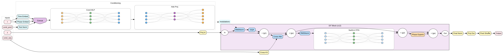
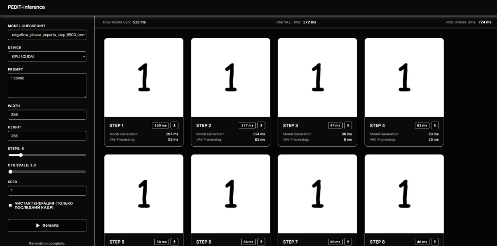
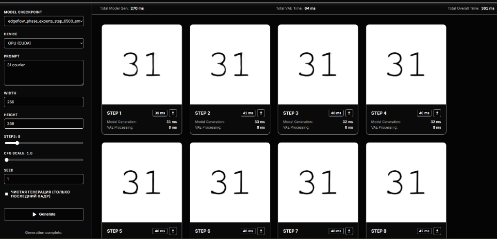
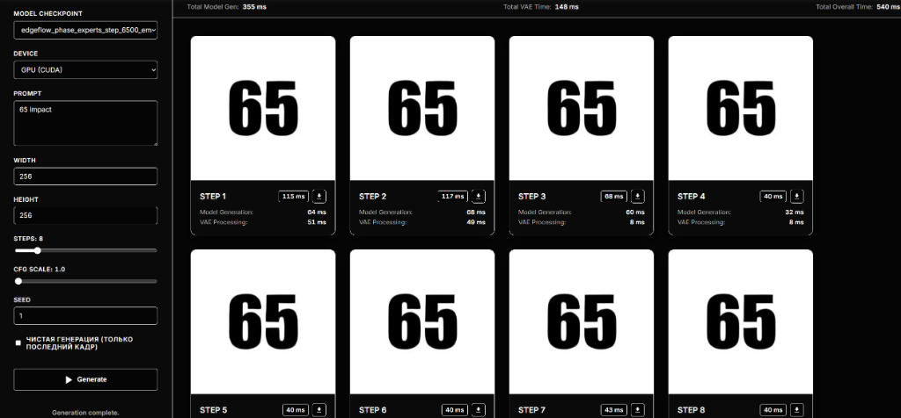

PEDiT (Phase-Expert Diffusion Transformer)

PEDiT is a diffusion model architecture I'm building for fast, photorealistic image generation on consumer GPUs with 8 GB VRAM or less. The root folder holds the original September 100M inference PoC, and PEDiT_V2/ contains the current codebase scaling toward photorealism and the FLUX VAE.

PEDiT V2 (Current Research & 150M PoC)

Instead of running one dense network at every step, PEDiT pairs a shared backbone with three phase experts selected by timestep. Each expert handles its own noise range, which cuts active parameters per step, lowers peak VRAM, and avoids interference between coarse layout and fine detail. Rectified Flow lets the base model generate in 12 steps instead of 24–30. For low-spec hardware (down to 8 GB RAM / 6 GB VRAM), only the active expert stays in VRAM while the rest stream asynchronously from storage to RAM to VRAM over background CUDA streams.

After the 100M generalization test, I trained a 150M-parameter run on 75k image-text pairs (55k human portraits, 20k cats and dogs) at 512x512 (256 latent tokens) using the DC-AE (f=32) autoencoder, batch size 32, and gradient accumulation 3. Quality stalled around 60k steps. Checking each expert individually showed that Expert 2 was doing fine while Experts 0 and 1 were lagging behind. Switching gradient accumulation to 5 with a 40% Expert 0 / 40% Expert 1 / 20% Expert 2 training split and pushing to 85k steps broke the plateau — clean facial and animal contours, no cross-species artifacts, and solid prompt adherence across hair color, age, gender, skin tone, and breeds.

60k steps (before expert rebalance):

85k steps (after 40/40/20 rebalance):

DC-AE's f=32 compression keeps token counts low, but it physically loses micro-textures like skin pores and eyelashes. To hit actual photorealism, V2 moves to the FLUX VAE (f=8 with 2x2 patchification, 4,096 latent tokens at 1024x1024).

Benchmarks on a full 4B INT8 test matrix (measured with torch.compile on a desktop RTX 3060 12 GB, 7.2–7.8 GB peak VRAM, targeting a hard 7.0 GB ceiling):
DC-AE @ 512x512 (256 tokens): 3.6s for 12 steps
DC-AE @ 1024x1024 (1,024 tokens): 14s for 12 steps, 18s for 18 steps
FLUX VAE @ 1024x1024 (4,096 tokens): 20s for 12 steps, 30s for 18 steps

Right now I'm running ablations in PEDiT_V2/ to validate the 4,096-token FLUX VAE pipeline, inverted multi-layer text conditioning (feeding Expert 0 late global-semantics layers like Layer 28 and Expert 2 early surface-detail layers like Layer 8), expert balance schedules, progressive resolution scaling (256 -> 512 -> 1024 with 2D RoPE), and a 3x3 MultiScale Depthwise Conv to kill patch seams. Next up is scaling to PEDiT Base 1 (4B) with open weights and full training/inference/streaming code, followed by a pruned/distilled Turbo variant (~2–2.5B), an expanded Pro model (~8B), and 4–8 step CFG-less Lightning distillations.

PEDiT_V2/ layout:
PEDiT_V2/model/ — updated DiT + Time-Aware MoE architecture (model.py), config, encoders, sampler, rectified_flow.py, compile_optimizer.py, and async weight streamer.py.
PEDiT_V2/train/ — latent caching (prepare_cache.py, dataset_cached.py) and training loop (train.py, efficiency.py).
PEDiT_V2/inference/ — V2 inference script.
PEDiT_V2/assets/ — 60k and 85k comparison grids.

PEDiT-100M (Initial September PoC)

The root directory holds the first ~100M-parameter Phase Rectified Flow DiT prototype, running sub-second inference (300–500 ms per image) on an RTX 3060. Checkpoints in FP16 (~206 MB), FP8 (~103 MB), and INT8 (~103 MB) are available on Hugging Face at https://huggingface.co/AIT-FT/PEDiT-100M and download automatically on first run.

The 100M model uses 12 DiT blocks with Grouped-Query Attention (GQA), RMSNorm, SwiGLU FFN, phase-specific experts, adaptive modulation (timestep + phase + pooled mT5 text embeddings), and a lightweight TAESD VAE decoder (8–50 ms decode time).

It was trained on rendering two-digit numbers from 1 to 99 across 5 fonts (arial, times, courier, comic, impact). To test out-of-distribution generalization rather than dataset memorization, the number 31 was completely excluded from training — the model saw 1 and 3 separately and in other combinations, never 31 together. At inference time it rendered 31 cleanly across all 5 fonts.

Prompts follow the format "<number> " (e.g. "31 courier", "1 comic", "65 impact"). Unedited 8-step Euler generations captured from the local Web UI on an RTX 3060 (30–45 ms per step):

1 comic:

31 courier (zero-shot holdout, 31–33 ms/step + 8 ms VAE decode, 361 ms total):

65 impact (~540 ms total):

Running the 100M PoC
Clone https://github.com/AIT-FT/PEDiT-inference-100M.git and launch the Web UI (http://localhost:8000) via run_server.bat on Windows or ./run_server.sh on Linux/macOS (or run_inference.bat / ./run_inference.sh for CLI). Models can also be pre-fetched with download_models.bat, ./download_models.sh, or "python download_utils.py --all" (supports --model fp16, fp8, int8). Recommended settings: 256x256 resolution, 8 Euler steps, CFG 1.0 (or 1.2–1.5 for stricter font adherence).

Root files: server.py (FastAPI + WebSocket UI), inference.py, model.py (EdgeFlowPhaseV2), encoders.py (mT5 + TAESD), rectified_flow.py, download_utils.py, check_deps.py, export_tensorrt.py, static/, and assets/. Licensed under Apache 2.0.
